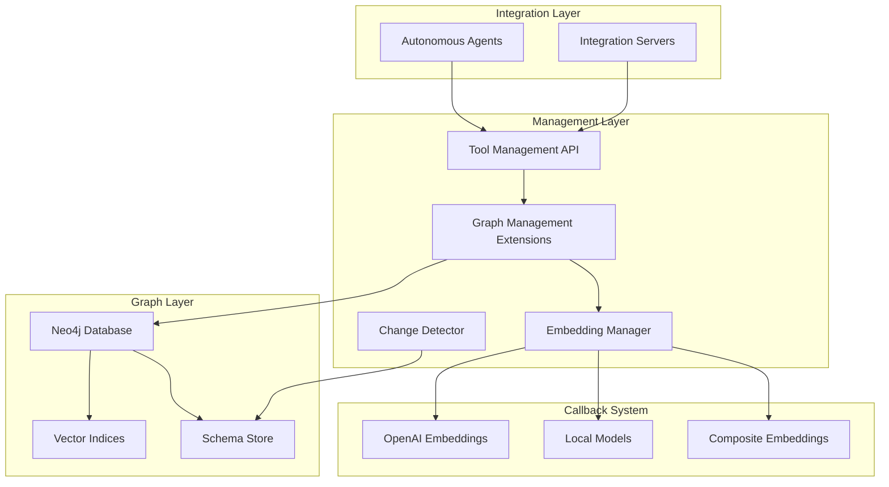

# Graph-Native Autonomous Agent Infrastructure

## Executive Summary

This document describes the advanced graph-native infrastructure for autonomous agents with sophisticated schema management, custom embedding generation, and intelligent redeployment capabilities. The system enables true agent autonomy through graph-based coordination and semantic understanding.

## Core Architecture



## Key Innovations

### 1. Advanced Schema Registration

The system supports three levels of schema complexity:

#### Node Schemas
```python
node_schema = NodeSchema(
    schema_id="agent_001",
    name="AutonomousAgent",
    labels=["Agent", "Autonomous"],
    properties=[...],
    embedding_fields=["name", "capabilities", "description"],
    vector_indices=[
        VectorIndexConfig(
            name="agent_vector_idx",
            dimension=1536,
            embedding_config=EmbeddingConfig(
                callback_id="openai_ada",
                update_trigger=["capabilities", "description"]
            )
        )
    ]
)
```

#### Relationship Schemas
```python
relationship_schema = RelationshipSchema(
    schema_id="coordinates_rel",
    relationship_type="COORDINATES",
    start_node_labels=["Agent"],
    end_node_labels=["Agent"],
    cardinality="one_to_many"
)
```

#### Hierarchical Subgraph Schemas
```python
# For complex structures like Conversation → Message → ContentBlock
subgraph_schema = SubgraphSchema(
    schema_id="conversation_hierarchy",
    root_node_schema="conversation_schema_id",
    child_schemas=[
        {"schema_id": "message_schema", "level": 1},
        {"schema_id": "content_block_schema", "level": 2}
    ],
    traversal_patterns=[
        "(c:Conversation)-[:HAS_MESSAGE]->(m:Message)",
        "(m:Message)-[:HAS_CONTENT]->(b:ContentBlock)"
    ]
)
```

### 2. Custom Embedding Callback System

The system supports pluggable embedding generation with caching and batch processing:

```python
# Register different embedding callbacks
embedding_manager.register_callback(
    "openai_ada",
    OpenAIEmbeddingCallback(model="text-embedding-ada-002")
)

embedding_manager.register_callback(
    "local_bert",
    LocalEmbeddingCallback(model_path="/models/bert", dimension=768)
)

# Composite embeddings for multi-modal understanding
embedding_manager.register_callback(
    "multi_modal",
    CompositeEmbeddingCallback(
        callbacks=[openai_cb, local_cb],
        strategy="concatenate"  # or "average", "weighted"
    )
)
```

### 3. Smart Redeployment with Change Detection

The system tracks schema and code changes to avoid unnecessary recomputation:

```python
# Only re-embed if schema or code changed
if not change_detector.has_schema_changed(schema_id, new_schema):
    logger.info(f"Schema {schema_id} unchanged, skipping re-embedding")
    return cached_result

# Track dependencies
change_detector.add_dependency("child_schema", "parent_schema")

# Get all affected schemas when something changes
affected = change_detector.get_affected_schemas("changed_schema_id")
```

### 4. Agent Orchestration Patterns

The system supports multiple coordination patterns for autonomous agents:

#### Hierarchical Coordination
```python
await orchestrator.create_agent_coordination(
    coordinator_id="master_orchestrator",
    worker_ids=["worker_001", "worker_002", "worker_003"],
    coordination_type="hierarchical"
)
```

#### Peer-to-Peer Coordination
```python
await orchestrator.create_agent_coordination(
    coordinator_id="peer_001",
    worker_ids=["peer_002", "peer_003"],
    coordination_type="peer_to_peer"
)
```

#### Consensus-Based Coordination
```python
await orchestrator.create_agent_coordination(
    coordinator_id="consensus_leader",
    worker_ids=["voter_001", "voter_002", "voter_003"],
    coordination_type="consensus",
    rules={"min_votes": 2, "timeout_ms": 5000}
)
```

## Vector Index Management

### Creating Vector Indices

Vector indices are created automatically when schemas are registered with embedding configurations:

```cypher
CREATE VECTOR INDEX agent_capabilities_idx IF NOT EXISTS
FOR (a:Agent)
ON a.embedding
OPTIONS {
    indexConfig: {
        `vector.dimensions`: 1536,
        `vector.similarity_function`: 'cosine',
        `m`: 16,
        `ef_construction`: 200
    }
}
```

### Embedding Generation Flow

1. **Schema Registration** → Defines which fields contribute to embeddings
2. **Callback Selection** → Choose appropriate embedding model
3. **Content Extraction** → Extract relevant fields based on schema
4. **Embedding Generation** → Call registered callback
5. **Caching** → Store embeddings with TTL
6. **Index Update** → Update Neo4j vector index

### Vector Search Operations

```python
# Find similar agents by capabilities
similar_agents = await orchestrator.find_similar_agents(
    capabilities=["reasoning", "planning"],
    limit=5
)

# Semantic tool search
tools = await search_tools_by_embedding(
    prompt="Process CSV files and generate reports",
    min_similarity=0.8
)
```

## Hierarchical Schema Examples

### Conversation Hierarchy

```python
# Register complete conversation structure
conversation_schema = await orchestrator.register_conversation_hierarchy(
    conversation_id="conv_001",
    embedding_config=EmbeddingConfig(
        callback_id="openai_ada",
        dimension=1536,
        update_trigger=["content", "title"]
    )
)
```

This creates:
- **Conversation** nodes with summary embeddings
- **Message** nodes with content embeddings
- **ContentBlock** nodes for structured content
- Relationships maintaining hierarchy

### Agent Memory Hierarchy

```python
# Agent → Memory → Fact structure
memory_hierarchy = SubgraphSchema(
    root_node_schema="agent_schema",
    child_schemas=[
        {"schema_id": "memory_schema", "level": 1},
        {"schema_id": "fact_schema", "level": 2},
        {"schema_id": "source_schema", "level": 3}
    ]
)
```

## Integration Patterns

### Pattern 1: Tool Registration with Embeddings

```python
# Integration server registers tool with semantic understanding
tool_registration = ToolRegistration(
    tool=ToolModel(...),
    action=ToolActionModel(...),
    input_schema=ToolSchemaModel(
        json_schema={...},
        embedding=await embedding_manager.generate_embedding(
            "tool_semantic",
            {"description": tool_desc, "capabilities": tool_caps}
        )
    )
)

await client.register_tool(tool_registration)
```

### Pattern 2: Agent Deployment with Coordination

```python
# Deploy agent team with roles
orchestrator = await register_agent(AgentSchema(
    agent_id="orchestrator_001",
    type="orchestrator",
    capabilities=[PLANNING, COORDINATION],
    embedding_config=EmbeddingConfig(callback_id="openai_ada")
))

workers = []
for i in range(3):
    worker = await register_agent(AgentSchema(
        agent_id=f"worker_{i:03d}",
        type="worker",
        capabilities=[TOOL_USE, MEMORY],
        tools=["data_processor", "report_generator"]
    ))
    workers.append(worker)

# Establish coordination
await create_agent_coordination(
    coordinator_id=orchestrator.agent_id,
    worker_ids=[w.agent_id for w in workers],
    coordination_type="hierarchical"
)
```

### Pattern 3: Smart Schema Evolution

```python
# Detect changes and evolve schema
async def evolve_schema(schema_id: str, updates: dict):
    # Check for changes
    change_result = await check_schema_changes(
        schema_id=schema_id,
        check_dependencies=True
    )

    if not change_result["changed"]:
        return "No changes detected"

    # Update schema
    await register_schema_with_embedding(
        schema_type="node",
        schema_definition=updates,
        skip_if_unchanged=True
    )

    # Recompute embeddings only for affected schemas
    for affected_id in change_result["affected_schemas"]:
        await trigger_embedding_recomputation(
            schema_id=affected_id,
            callback_id="openai_ada"
        )
```

## Performance Optimizations

### 1. Embedding Cache Strategy

```python
class EmbeddingCache:
    TTL = timedelta(hours=24)  # Cache for 24 hours

    async def get_or_compute(self, key: str, compute_fn):
        if cached := self.get_cached(key):
            return cached

        result = await compute_fn()
        self.cache[key] = (result, datetime.utcnow())
        return result
```

### 2. Batch Processing

```python
# Process embeddings in batches
await embedding_manager.batch_generate(
    callback_id="openai_ada",
    contents=large_content_list,
    batch_size=100  # Process 100 at a time
)
```

### 3. Lazy Evaluation

```python
# Only compute embeddings when needed
if schema.vector_indices and update_triggered(data, schema.update_trigger):
    await update_embeddings(schema_id, data)
```

## Graph Queries for Agent Operations

### Find Capable Agents

```cypher
// Find agents that can handle specific tools
MATCH (a:Agent)-[:HAS_CAPABILITY]->(:Capability {name: 'tool_use'})
MATCH (a)-[:CAN_USE]->(t:Tool)
WHERE t.name IN $required_tools
RETURN a
```

### Agent Coordination Paths

```cypher
// Find coordination hierarchy
MATCH path = (orchestrator:Agent {type: 'orchestrator'})
  -[:COORDINATES*1..3]->(worker:Agent)
RETURN path
```

### Schema Evolution Tracking

```cypher
// Track schema evolution
MATCH (s1:Schema)-[:EVOLVED_TO*]->(s2:Schema)
WHERE s1.schema_id = $original_id
RETURN s1, s2, length(path) as evolution_distance
```

## Security and Access Control

### Capability Tokens for Agents

```python
# Create capability token for agent
token = await create_capability_token(
    agent_id="agent_001",
    capabilities=["read_schema", "execute_tool"],
    budget_per_day=1000,
    expires_at="2024-12-31T23:59:59Z"
)
```

### Schema Access Control

```cypher
// Enforce organization boundaries
MATCH (s:Schema)
WHERE s.organization_id = $org_id
  AND s.visibility IN ['public', 'organization']
RETURN s
```

## Monitoring and Observability

### Key Metrics

1. **Embedding Generation**
   - Cache hit rate
   - Generation latency
   - Batch processing throughput

2. **Schema Changes**
   - Change frequency
   - Affected dependency count
   - Recomputation time

3. **Agent Coordination**
   - Message passing latency
   - Coordination conflicts
   - Task completion rate

### Monitoring Queries

```cypher
// Embedding generation stats
MATCH (n)
WHERE n.embedding IS NOT NULL
RETURN labels(n)[0] as type,
       count(*) as embedded_count,
       avg(size(n.embedding)) as avg_dimension

// Schema change frequency
MATCH (s:Schema)
WHERE s.updated_at > datetime() - duration('P7D')
RETURN date(s.updated_at) as date,
       count(*) as changes
ORDER BY date

// Agent utilization
MATCH (a:Agent)
OPTIONAL MATCH (a)-[r:EXECUTED]->(t:Tool)
WHERE r.timestamp > datetime() - duration('PT1H')
RETURN a.agent_id,
       a.state,
       count(r) as executions_last_hour
```

## Deployment Considerations

### 1. Graph Management API Extensions

Deploy the extensions alongside your Graph Management API:

```bash
# Start Graph Management Extensions
python graph_management_extensions.py

# Runs on port 8001 by default
# Connects to Graph Management API at localhost:2014
```

### 2. Embedding Service Setup

Configure embedding callbacks based on your infrastructure:

```python
# For cloud deployment
embedding_manager.register_callback(
    "openai_production",
    OpenAIEmbeddingCallback(
        api_key=os.getenv("OPENAI_API_KEY"),
        model="text-embedding-ada-002"
    )
)

# For on-premise deployment
embedding_manager.register_callback(
    "local_production",
    LocalEmbeddingCallback(
        model_path="/opt/models/sentence-transformers",
        dimension=768
    )
)
```

### 3. Neo4j Configuration

Ensure Neo4j is configured for vector operations:

```conf
# neo4j.conf
dbms.memory.heap.initial_size=2g
dbms.memory.heap.max_size=4g
dbms.memory.pagecache.size=2g

# Enable GDS for vector operations
dbms.security.procedures.unrestricted=gds.*
```

## Migration Strategy

### From Simple to Advanced Schemas

1. **Phase 1**: Register basic node schemas
2. **Phase 2**: Add embedding configurations
3. **Phase 3**: Implement hierarchical structures
4. **Phase 4**: Enable change detection
5. **Phase 5**: Deploy autonomous agents

### Backward Compatibility

The system maintains backward compatibility through:
- Schema versioning
- Optional embedding fields
- Gradual migration paths
- Fallback to non-embedded search

## Future Enhancements

### Planned Features

1. **Multi-Modal Embeddings**
   - Image embeddings for visual tools
   - Audio embeddings for voice agents
   - Video understanding for complex tasks

2. **Federated Learning**
   - Distributed embedding computation
   - Privacy-preserving aggregation
   - Cross-organization model sharing

3. **Adaptive Coordination**
   - Self-organizing agent teams
   - Dynamic role assignment
   - Performance-based reorganization

4. **Advanced Graph Algorithms**
   - Community detection for agent clustering
   - PageRank for tool importance
   - Path finding for optimal coordination

## Conclusion

This graph-native autonomous agent infrastructure provides:

- **True Autonomy**: Agents operate independently with graph-based coordination
- **Semantic Understanding**: Custom embeddings enable semantic search and similarity
- **Smart Deployment**: Change detection prevents unnecessary recomputation
- **Scalable Architecture**: Hierarchical schemas support complex structures
- **Future-Proof Design**: Extensible callback system adapts to new embedding models

The system represents a significant advance in tool management and agent orchestration, enabling truly intelligent and autonomous agent behavior through graph-native infrastructure.