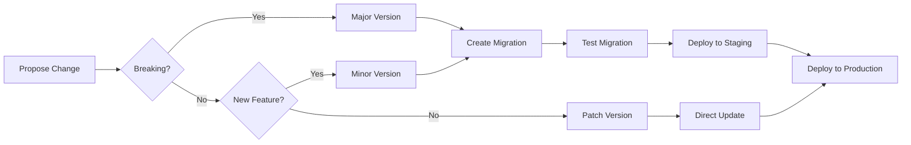

# Graph Management Service Specification
## Complete Graph Infrastructure for Autonomous Agent System

### Version 2.0 - Production Ready
### Date: November 2024
### For: Graph Management Service Team

---

## Executive Summary

This document provides the complete specification for implementing the graph infrastructure required by the Autonomous Agent System. It details all node types, relationships, schemas, indices, procedures, and operational requirements needed to support dynamic tool registration, agent orchestration, and semantic understanding through embeddings.

---

## Table of Contents

1. [Graph Data Model Overview](#graph-data-model-overview)
2. [Node Specifications](#node-specifications)
3. [Relationship Specifications](#relationship-specifications)
4. [Schema Management Layer](#schema-management-layer)
5. [Vector Index Requirements](#vector-index-requirements)
6. [Graph Procedures and Functions](#graph-procedures-and-functions)
7. [Query Patterns and Templates](#query-patterns-and-templates)
8. [Performance Requirements](#performance-requirements)
9. [Security and Access Control](#security-and-access-control)
10. [Migration and Evolution](#migration-and-evolution)
11. [Monitoring and Observability](#monitoring-and-observability)
12. [Implementation Checklist](#implementation-checklist)

---

## 1. Graph Data Model Overview

### Core Concepts

The graph implements a multi-layered architecture:

```
┌─────────────────────────────────────────────────────────────────┐
│                         SCHEMA LAYER                             │
│  (Schema, NodeSchema, RelationshipSchema, SubgraphSchema)        │
└─────────────────────────────────────────────────────────────────┘
                              ▼
┌─────────────────────────────────────────────────────────────────┐
│                        INSTANCE LAYER                            │
│  (Tool, Agent, Conversation, Message, Execution)                 │
└─────────────────────────────────────────────────────────────────┘
                              ▼
┌─────────────────────────────────────────────────────────────────┐
│                      COORDINATION LAYER                          │
│  (COORDINATES, DELEGATES_TO, REPORTS_TO, COLLABORATES_WITH)     │
└─────────────────────────────────────────────────────────────────┘
                              ▼
┌─────────────────────────────────────────────────────────────────┐
│                       EMBEDDING LAYER                            │
│  (Vector Indices, Similarity Functions, Semantic Search)         │
└─────────────────────────────────────────────────────────────────┘
```

### Design Principles

1. **Schema-First**: All data must conform to registered schemas
2. **Embedding-Native**: Semantic understanding through vector embeddings
3. **Change-Aware**: Track and respond to schema/code changes
4. **Hierarchical**: Support nested and composite structures
5. **Versioned**: All schemas and tools maintain version history

---

## 2. Node Specifications

### 2.1 Schema Nodes

#### Schema (Base Label)
```cypher
(:Schema {
    schema_id: String! UNIQUE,           // Unique identifier
    schema_type: String!,                 // 'node', 'relationship', 'subgraph', 'pattern'
    name: String!,                        // Human-readable name
    version: String!,                     // Semantic version (MAJOR.MINOR.PATCH)
    description: String,                  // Description of the schema
    created_at: DateTime!,                // Creation timestamp
    updated_at: DateTime!,                // Last update timestamp
    created_by: String,                   // User/service that created it
    organization_id: String INDEX,        // Organization owning the schema
    environment: String,                  // 'dev', 'staging', 'production'
    status: String!,                      // 'draft', 'active', 'deprecated'
    content_hash: String! INDEX,          // SHA256 hash of schema content
    dependencies: [String],               // Array of dependent schema IDs
    tags: [String],                       // Categorization tags
    metadata: JSON                        // Additional metadata
})
```

#### NodeSchema (Extends Schema)
```cypher
(:NodeSchema:Schema {
    labels: [String]!,                   // Neo4j labels for instances
    properties: JSON!,                    // Property definitions
    constraints: JSON,                    // Constraint definitions
    indices: JSON,                        // Index definitions
    vector_indices: JSON,                 // Vector index configurations
    embedding_fields: [String],           // Fields to include in embeddings
    embedding_config: JSON,               // Embedding generation config
    validation_rules: JSON,               // Validation rules
    default_values: JSON,                 // Default property values
    required_properties: [String],       // Required properties
    unique_properties: [String],         // Properties that must be unique
    indexed_properties: [String],        // Properties to index
    computed_properties: JSON,            // Properties computed from others
    lifecycle_hooks: JSON                 // onCreate, onUpdate, onDelete hooks
})
```

#### RelationshipSchema (Extends Schema)
```cypher
(:RelationshipSchema:Schema {
    relationship_type: String!,           // Neo4j relationship type
    start_node_labels: [String]!,        // Valid start node labels
    end_node_labels: [String]!,          // Valid end node labels
    cardinality: String!,                 // 'one_to_one', 'one_to_many', 'many_to_many'
    properties: JSON!,                    // Property definitions
    constraints: JSON,                    // Relationship constraints
    required_properties: [String],       // Required properties
    validation_rules: JSON,               // Validation rules
    bidirectional: Boolean,               // If relationship is bidirectional
    transitive: Boolean,                  // If relationship is transitive
    temporal: Boolean,                    // If relationship is time-bound
    weight_property: String,              // Property used for weighted algorithms
    cascade_delete: Boolean               // Delete behavior
})
```

#### SubgraphSchema (Extends Schema)
```cypher
(:SubgraphSchema:Schema {
    root_node_schema: String!,            // Root schema ID
    child_schemas: JSON!,                 // Array of {schema_id, level, cardinality}
    relationships: JSON!,                 // Relationship definitions within subgraph
    traversal_patterns: [String]!,        // Cypher patterns for traversal
    aggregation_rules: JSON,              // Rules for aggregating data
    composition_type: String,             // 'hierarchy', 'network', 'tree', 'dag'
    max_depth: Integer,                   // Maximum traversal depth
    circular_allowed: Boolean,            // Whether circular references allowed
    ordering_property: String,            // Property for ordering children
    partition_strategy: JSON              // How to partition large subgraphs
})
```

### 2.2 Instance Nodes

#### Tool
```cypher
(:Tool {
    tool_id: String! UNIQUE,              // Unique identifier
    name: String! INDEX,                  // Tool name
    description: String,                  // Tool description
    version: String!,                     // Tool version
    schema_id: String! INDEX,             // Reference to NodeSchema
    service_name: String! INDEX,          // Owning service
    service_url: String!,                 // Service endpoint
    visibility: String! INDEX,            // 'public', 'private', 'organization'
    status: String! INDEX,                // 'active', 'deprecated', 'disabled'
    created_at: DateTime! INDEX,          // Creation timestamp
    updated_at: DateTime! INDEX,          // Last update
    last_used_at: DateTime INDEX,         // Last execution time
    usage_count: Integer DEFAULT 0,       // Number of executions
    success_rate: Float,                  // Success percentage
    avg_duration_ms: Float,               // Average execution time
    rating: Float,                        // User rating (0-5)
    tags: [String] INDEX,                 // Categorization
    category: String INDEX,               // Primary category
    organization_id: String INDEX,        // Organization owner
    user_id: String INDEX,                // User who created it
    toolkit_id: String INDEX,             // Toolkit membership
    dependencies: [String],               // Tool dependencies
    capabilities: [String],               // Tool capabilities
    embedding: [Float] VECTOR(1536),      // Semantic embedding
    capability_embedding: [Float] VECTOR(768), // Capability-specific embedding
    performance_metrics: JSON,            // Detailed performance data
    configuration: JSON,                  // Tool configuration
    metadata: JSON                        // Additional metadata
})
```

#### ToolAction
```cypher
(:ToolAction {
    action_id: String! UNIQUE,            // Unique identifier
    tool_id: String! INDEX,               // Parent tool ID
    type: String!,                        // 'http', 'grpc', 'websocket', 'lambda'
    method: String,                       // HTTP method if applicable
    url: String!,                         // Endpoint URL
    timeout_ms: Integer DEFAULT 30000,    // Timeout in milliseconds
    retry_policy: JSON,                   // Retry configuration
    auth_type: String,                    // 'none', 'bearer', 'api_key', 'oauth2'
    auth_config: JSON,                    // Authentication configuration
    headers: JSON,                        // Default headers
    rate_limit: JSON,                     // Rate limiting config
    circuit_breaker: JSON,                // Circuit breaker config
    batch_config: JSON,                   // Batching configuration
    cache_config: JSON,                   // Caching configuration
    monitoring_config: JSON               // Monitoring/tracing config
})
```

#### ToolSchema
```cypher
(:ToolSchema {
    schema_id: String! UNIQUE,            // Unique identifier
    tool_id: String! INDEX,               // Parent tool ID
    schema_type: String!,                 // 'input' or 'output'
    version: String!,                     // Schema version
    json_schema: JSON!,                   // JSON Schema definition
    validation_rules: JSON,               // Additional validation
    examples: JSON,                       // Example valid data
    transformation_rules: JSON,           // Data transformation rules
    created_at: DateTime!,                // Creation timestamp
    embedding: [Float] VECTOR(768),       // Schema embedding
    compatibility_version: String,        // Min compatible version
    migration_path: JSON                  // Migration from previous versions
})
```

#### Agent
```cypher
(:Agent {
    agent_id: String! UNIQUE,             // Unique identifier
    name: String! INDEX,                  // Agent name
    type: String! INDEX,                  // 'orchestrator', 'worker', 'specialist'
    status: String! INDEX,                // 'initializing', 'ready', 'working', 'suspended'
    model: String!,                       // LLM model
    temperature: Float,                   // Model temperature
    max_tokens: Integer,                  // Max token limit
    capabilities: [String] INDEX,         // Agent capabilities
    tools: [String],                      // Available tools
    created_at: DateTime! INDEX,          // Creation timestamp
    last_active: DateTime INDEX,          // Last activity
    total_tasks: Integer DEFAULT 0,       // Total tasks processed
    success_rate: Float,                  // Success percentage
    avg_response_time_ms: Float,          // Average response time
    memory_schema_id: String,             // Memory schema reference
    coordination_schema_id: String,       // Coordination schema
    embedding: [Float] VECTOR(1536),      // Agent embedding
    skill_embedding: [Float] VECTOR(768), // Skills-based embedding
    performance_metrics: JSON,            // Performance data
    configuration: JSON,                  // Agent configuration
    metadata: JSON                        // Additional metadata
})
```

#### Conversation
```cypher
(:Conversation {
    conversation_id: String! UNIQUE,      // Unique identifier
    title: String INDEX,                  // Conversation title
    created_at: DateTime! INDEX,          // Creation timestamp
    updated_at: DateTime! INDEX,          // Last update
    status: String! INDEX,                // 'active', 'paused', 'completed', 'archived'
    agent_ids: [String],                  // Participating agents
    total_messages: Integer DEFAULT 0,    // Message count
    total_tokens: Integer DEFAULT 0,      // Token usage
    context_window: Integer,              // Context window size
    summary: String,                      // Conversation summary
    summary_embedding: [Float] VECTOR(1536), // Summary embedding
    topics: [String],                     // Identified topics
    sentiment_score: Float,               // Overall sentiment
    metadata: JSON                        // Additional metadata
})
```

#### Message
```cypher
(:Message {
    message_id: String! UNIQUE,           // Unique identifier
    conversation_id: String! INDEX,       // Parent conversation
    role: String!,                        // 'system', 'user', 'assistant'
    content: String,                      // Message content
    timestamp: DateTime! INDEX,           // Message timestamp
    agent_id: String INDEX,               // Agent that created it
    token_count: Integer,                 // Token usage
    order_index: Integer,                 // Message order
    parent_message_id: String,            // For threaded conversations
    embedding: [Float] VECTOR(1536),      // Content embedding
    intent: String,                       // Detected intent
    entities: JSON,                       // Extracted entities
    sentiment: Float,                     // Message sentiment
    metadata: JSON                        // Additional metadata
})
```

#### ContentBlock
```cypher
(:ContentBlock {
    block_id: String! UNIQUE,             // Unique identifier
    message_id: String! INDEX,            // Parent message
    block_type: String!,                  // 'text', 'code', 'image', 'tool_call', 'result'
    content: JSON!,                       // Block content
    order_index: Integer!,                // Block order
    language: String,                     // For code blocks
    mime_type: String,                    // Content MIME type
    size_bytes: Integer,                  // Content size
    metadata: JSON                        // Additional metadata
})
```

#### Execution
```cypher
(:Execution {
    execution_id: String! UNIQUE,         // Unique identifier
    timestamp: DateTime! INDEX,           // Execution time
    agent_id: String INDEX,               // Executing agent
    tool_id: String INDEX,                // Executed tool
    conversation_id: String INDEX,        // Related conversation
    status: String!,                      // 'started', 'running', 'completed', 'failed'
    duration_ms: Integer,                 // Execution duration
    input_data: JSON,                     // Input data
    output_data: JSON,                    // Output data
    error: String,                        // Error message if failed
    retry_count: Integer DEFAULT 0,       // Number of retries
    metrics: JSON,                        // Execution metrics
    trace_id: String,                     // Distributed tracing ID
    span_id: String,                      // Span ID
    metadata: JSON                        // Additional metadata
})
```

### 2.3 Management Nodes

#### Organization
```cypher
(:Organization {
    org_id: String! UNIQUE,               // Unique identifier
    name: String! INDEX,                  // Organization name
    created_at: DateTime!,                // Creation timestamp
    status: String!,                      // 'active', 'suspended', 'deleted'
    tier: String,                         // 'free', 'pro', 'enterprise'
    limits: JSON,                         // Usage limits
    settings: JSON,                       // Organization settings
    metadata: JSON                        // Additional metadata
})
```

#### Project
```cypher
(:Project {
    project_id: String! UNIQUE,           // Unique identifier
    org_id: String! INDEX,                // Parent organization
    name: String! INDEX,                  // Project name
    created_at: DateTime!,                // Creation timestamp
    environment: String!,                 // 'dev', 'staging', 'prod'
    status: String!,                      // 'active', 'paused', 'archived'
    settings: JSON,                       // Project settings
    metadata: JSON                        // Additional metadata
})
```

#### User
```cypher
(:User {
    user_id: String! UNIQUE,              // Unique identifier
    email: String! UNIQUE,                // Email address
    name: String INDEX,                   // Display name
    org_id: String INDEX,                 // Organization membership
    created_at: DateTime!,                // Account creation
    last_login: DateTime,                 // Last login time
    status: String!,                      // 'active', 'suspended', 'deleted'
    roles: [String],                      // User roles
    permissions: [String],                // Direct permissions
    preferences: JSON,                    // User preferences
    metadata: JSON                        // Additional metadata
})
```

#### CapabilityToken
```cypher
(:CapabilityToken {
    token_id: String! UNIQUE,             // Unique identifier
    token_hash: String! UNIQUE,           // SHA256 hash of token
    subject: String! INDEX,               // Who token is for
    issuer: String! INDEX,                // Who issued it
    type: String!,                        // 'tool_execution', 'schema_write', etc.
    permissions: [String]!,               // Granted permissions
    constraints: JSON,                    // Usage constraints
    budget_per_day: Integer,              // Daily usage limit
    usage_today: Integer DEFAULT 0,       // Current day usage
    created_at: DateTime!,                // Issue time
    expires_at: DateTime INDEX,           // Expiration time
    revoked: Boolean DEFAULT false,       // Revocation status
    last_used: DateTime,                  // Last usage time
    metadata: JSON                        // Additional metadata
})
```

---

## 3. Relationship Specifications

### 3.1 Schema Relationships

#### EXTENDS
```cypher
(:Schema)-[:EXTENDS {
    inherited_properties: [String],       // Properties inherited
    override_properties: [String],        // Properties overridden
    added_properties: [String]            // New properties added
}]->(:Schema)
```

#### EVOLVED_TO
```cypher
(:Schema)-[:EVOLVED_TO {
    evolution_type: String!,              // 'major', 'minor', 'patch'
    breaking_changes: Boolean,            // Has breaking changes
    migration_required: Boolean,          // Requires data migration
    migration_script: String,             // Migration script reference
    evolved_at: DateTime!,                // Evolution timestamp
    evolved_by: String                    // User/service that evolved it
}]->(:Schema)
```

#### DEPENDS_ON
```cypher
(:Schema)-[:DEPENDS_ON {
    dependency_type: String!,             // 'required', 'optional'
    version_constraint: String,           // Version requirement
    features_used: [String]               // Specific features depended on
}]->(:Schema)
```

#### HAS_ROOT
```cypher
(:SubgraphSchema)-[:HAS_ROOT {
    traversal_direction: String,          // 'outgoing', 'incoming', 'both'
    max_depth: Integer                    // Maximum traversal depth
}]->(:NodeSchema)
```

#### CONTAINS
```cypher
(:SubgraphSchema)-[:CONTAINS {
    level: Integer!,                      // Hierarchy level
    cardinality: String,                  // 'one', 'many'
    ordering: Integer,                    // Order within level
    required: Boolean                     // If required in subgraph
}]->(:Schema)
```

### 3.2 Instance Relationships

#### HAS_ACTION
```cypher
(:Tool)-[:HAS_ACTION {
    primary: Boolean DEFAULT false,       // Primary action
    order_index: Integer                  // Execution order
}]->(:ToolAction)
```

#### HAS_INPUT_SCHEMA
```cypher
(:Tool)-[:HAS_INPUT_SCHEMA {
    version: String!,                     // Schema version
    required: Boolean DEFAULT true        // If input required
}]->(:ToolSchema)
```

#### HAS_OUTPUT_SCHEMA
```cypher
(:Tool)-[:HAS_OUTPUT_SCHEMA {
    version: String!,                     // Schema version
    guaranteed: Boolean DEFAULT true      // If output guaranteed
}]->(:ToolSchema)
```

#### CAN_CHAIN_TO
```cypher
(:Tool)-[:CAN_CHAIN_TO {
    compatibility_score: Float!,          // 0.0 to 1.0
    mapping_rules: JSON,                  // Output to input mapping
    validated_at: DateTime,               // Last validation
    auto_chain: Boolean DEFAULT false     // Can auto-chain
}]->(:Tool)
```

#### EXECUTED
```cypher
(:Agent)-[:EXECUTED {
    execution_id: String!,                // Execution ID
    started_at: DateTime!,                // Start time
    completed_at: DateTime,               // Completion time
    success: Boolean,                     // Success status
    duration_ms: Integer                  // Duration
}]->(:Tool)
```

#### COORDINATES
```cypher
(:Agent)-[:COORDINATES {
    coordination_type: String!,           // 'hierarchical', 'peer_to_peer'
    priority: Integer,                    // Coordination priority
    assigned_at: DateTime!,               // Assignment time
    load_factor: Float,                   // Current load
    task_queue: JSON                      // Assigned tasks
}]->(:Agent)
```

#### DELEGATES_TO
```cypher
(:Agent)-[:DELEGATES_TO {
    task_id: String!,                     // Delegated task ID
    delegated_at: DateTime!,              // Delegation time
    deadline: DateTime,                   // Task deadline
    priority: Integer,                    // Task priority
    context: JSON                         // Task context
}]->(:Agent)
```

#### HAS_MESSAGE
```cypher
(:Conversation)-[:HAS_MESSAGE {
    order_index: Integer!,                // Message order
    branch: String                        // For branched conversations
}]->(:Message)
```

#### FOLLOWS
```cypher
(:Message)-[:FOLLOWS {
    time_gap_ms: Integer,                 // Time between messages
    causality: String                     // 'direct', 'indirect'
}]->(:Message)
```

#### HAS_CONTENT
```cypher
(:Message)-[:HAS_CONTENT {
    order_index: Integer!                 // Content order
}]->(:ContentBlock)
```

### 3.3 Access Control Relationships

#### OWNS
```cypher
(:Organization)-[:OWNS {
    acquired_at: DateTime!,               // Ownership start
    ownership_type: String                // 'created', 'transferred'
}]->(:Tool|:Schema|:Agent)
```

#### HAS_ACCESS
```cypher
(:User)-[:HAS_ACCESS {
    permission_level: String!,            // 'read', 'write', 'admin'
    granted_at: DateTime!,                // Grant time
    granted_by: String,                  // Granting user/service
    expires_at: DateTime                  // Expiration time
}]->(:Tool|:Schema|:Project)
```

#### MEMBER_OF
```cypher
(:User)-[:MEMBER_OF {
    role: String!,                        // User role
    joined_at: DateTime!,                 // Join time
    active: Boolean DEFAULT true          // Active membership
}]->(:Organization)
```

#### CREATED
```cypher
(:User)-[:CREATED {
    created_at: DateTime!,                // Creation time
    creation_context: JSON                // Creation context
}]->(:Tool|:Schema|:Agent)
```

---

## 4. Schema Management Layer

### 4.1 Schema Registration Process

```cypher
// Step 1: Validate schema
CALL graph.schema.validate($schema_definition)
YIELD valid, errors
RETURN valid, errors;

// Step 2: Check for conflicts
MATCH (existing:Schema {name: $name, version: $version})
WHERE existing.status = 'active'
RETURN COUNT(existing) > 0 as has_conflict;

// Step 3: Create schema with versioning
CREATE (s:NodeSchema:Schema {
    schema_id: $schema_id,
    name: $name,
    version: $version,
    content_hash: $content_hash,
    created_at: datetime(),
    status: 'draft'
})
SET s += $schema_properties
RETURN s;

// Step 4: Link to previous version if exists
MATCH (prev:Schema {name: $name})
WHERE prev.version < $version
WITH prev ORDER BY prev.version DESC LIMIT 1
MATCH (new:Schema {schema_id: $schema_id})
CREATE (prev)-[:EVOLVED_TO {
    evolution_type: $evolution_type,
    breaking_changes: $breaking_changes,
    evolved_at: datetime()
}]->(new);

// Step 5: Activate schema
MATCH (s:Schema {schema_id: $schema_id})
SET s.status = 'active'
RETURN s;
```

### 4.2 Schema Validation Rules

```javascript
// Property type validation
const VALID_PROPERTY_TYPES = [
    'string', 'integer', 'float', 'boolean',
    'datetime', 'date', 'time', 'duration',
    'array', 'object', 'json', 'point', 'vector'
];

// Constraint validation
const VALID_CONSTRAINTS = [
    'unique', 'exists', 'node_key',
    'relationship_key', 'property_type'
];

// Index types
const VALID_INDEX_TYPES = [
    'btree', 'fulltext', 'vector',
    'spatial', 'composite'
];
```

### 4.3 Schema Evolution Strategy

```cypher
// Detect breaking changes
CALL graph.schema.detectBreakingChanges($old_schema, $new_schema)
YIELD has_breaking_changes, changes
RETURN has_breaking_changes, changes;

// Generate migration plan
CALL graph.schema.generateMigration($old_version, $new_version)
YIELD migration_steps
RETURN migration_steps;

// Apply migration
CALL graph.schema.applyMigration($migration_plan)
YIELD success, migrated_count, errors
RETURN success, migrated_count, errors;
```

---

## 5. Vector Index Requirements

### 5.1 Vector Index Creation

```cypher
// Create vector index for tools
CREATE VECTOR INDEX tool_embedding_idx IF NOT EXISTS
FOR (t:Tool)
ON t.embedding
OPTIONS {
    indexConfig: {
        `vector.dimensions`: 1536,
        `vector.similarity_function`: 'cosine',
        `m`: 16,                          // HNSW M parameter
        `ef_construction`: 200,           // HNSW construction parameter
        `ef`: 100                         // HNSW search parameter
    }
};

// Create vector index for agents
CREATE VECTOR INDEX agent_capability_idx IF NOT EXISTS
FOR (a:Agent)
ON a.capability_embedding
OPTIONS {
    indexConfig: {
        `vector.dimensions`: 768,
        `vector.similarity_function`: 'euclidean',
        `m`: 12,
        `ef_construction`: 150,
        `ef`: 50
    }
};

// Create vector index for messages
CREATE VECTOR INDEX message_content_idx IF NOT EXISTS
FOR (m:Message)
ON m.embedding
OPTIONS {
    indexConfig: {
        `vector.dimensions`: 1536,
        `vector.similarity_function`: 'cosine',
        `m`: 16,
        `ef_construction`: 200,
        `ef`: 100
    }
};

// Create vector index for conversation summaries
CREATE VECTOR INDEX conversation_summary_idx IF NOT EXISTS
FOR (c:Conversation)
ON c.summary_embedding
OPTIONS {
    indexConfig: {
        `vector.dimensions`: 1536,
        `vector.similarity_function`: 'cosine',
        `m`: 8,
        `ef_construction`: 100,
        `ef`: 50
    }
};
```

### 5.2 Embedding Update Triggers

```cypher
// Procedure to update embeddings
CALL graph.embeddings.update({
    node_label: 'Tool',
    node_id: $tool_id,
    embedding_property: 'embedding',
    callback_id: 'openai_ada',
    fields_to_embed: ['name', 'description', 'capabilities'],
    force_update: false
}) YIELD updated, embedding_dimension;

// Batch update embeddings
CALL graph.embeddings.batchUpdate({
    node_label: 'Tool',
    where_clause: 'tool.status = "active" AND tool.embedding IS NULL',
    callback_id: 'openai_ada',
    batch_size: 100,
    parallel: true
}) YIELD total_updated, duration_ms;
```

### 5.3 Vector Search Patterns

```cypher
// Semantic tool search
CALL db.index.vector.queryNodes(
    'tool_embedding_idx',
    10,                                   // number of results
    $search_embedding                     // query vector
) YIELD node, score
WHERE node.status = 'active'
  AND node.visibility IN ['public', 'organization']
  AND score > 0.7
RETURN node, score
ORDER BY score DESC;

// Find similar agents
WITH $capability_requirements as caps
CALL graph.embeddings.generate('local_minilm', caps) YIELD embedding
CALL db.index.vector.queryNodes(
    'agent_capability_idx',
    5,
    embedding
) YIELD node as agent, score
WHERE agent.status = 'ready'
  AND score > 0.8
RETURN agent, score;

// Hybrid search (vector + filters)
CALL db.index.vector.queryNodes(
    'tool_embedding_idx',
    20,
    $search_embedding
) YIELD node as tool, score
WHERE tool.organization_id = $org_id
  AND tool.category IN $categories
  AND tool.rating >= $min_rating
  AND score > 0.6
RETURN tool, score
ORDER BY score * 0.7 + tool.rating * 0.3 DESC
LIMIT 10;
```

---

## 6. Graph Procedures and Functions

### 6.1 Required Custom Procedures

```java
// Schema Management Procedures
CALL graph.schema.register(schema_definition)
    YIELD schema_id, version, status;

CALL graph.schema.validate(schema_definition)
    YIELD valid, errors;

CALL graph.schema.evolve(schema_id, new_version, changes)
    YIELD migration_plan;

CALL graph.schema.getHistory(schema_name)
    YIELD versions;

CALL graph.schema.checkCompatibility(schema1_id, schema2_id)
    YIELD compatible, issues;

// Embedding Management Procedures
CALL graph.embeddings.generate(callback_id, content)
    YIELD embedding;

CALL graph.embeddings.update(config)
    YIELD updated, embedding_dimension;

CALL graph.embeddings.clearCache(older_than)
    YIELD cleared_count;

CALL graph.embeddings.registerCallback(callback_id, config)
    YIELD registered;

// Tool Management Procedures
CALL graph.tools.register(tool_definition)
    YIELD tool_id, status;

CALL graph.tools.findCompatible(tool_id)
    YIELD compatible_tools;

CALL graph.tools.validateChain(tool_ids)
    YIELD valid, issues;

CALL graph.tools.analyzeUsage(tool_id, time_range)
    YIELD metrics;

// Agent Management Procedures
CALL graph.agents.deploy(agent_config)
    YIELD agent_id, status;

CALL graph.agents.coordinate(coordinator_id, worker_ids, type)
    YIELD coordination_id;

CALL graph.agents.findCapable(capabilities)
    YIELD agents;

CALL graph.agents.getWorkload(agent_id)
    YIELD current_load, task_queue;

// Monitoring Procedures
CALL graph.monitor.getMetrics(node_label, time_range)
    YIELD metrics;

CALL graph.monitor.detectAnomalies(threshold)
    YIELD anomalies;

CALL graph.monitor.getPerformance()
    YIELD stats;
```

### 6.2 Required Functions

```cypher
// Hash functions
RETURN graph.hash.sha256($content) as hash;
RETURN graph.hash.contentHash($schema_definition) as content_hash;

// Version comparison
RETURN graph.version.compare($v1, $v2) as comparison; // -1, 0, 1
RETURN graph.version.isCompatible($v1, $v2) as compatible;

// Embedding operations
RETURN graph.embedding.cosineSimilarity($vec1, $vec2) as similarity;
RETURN graph.embedding.euclideanDistance($vec1, $vec2) as distance;

// Schema operations
RETURN graph.schema.diff($schema1, $schema2) as differences;
RETURN graph.schema.merge($schema1, $schema2) as merged;

// Validation functions
RETURN graph.validate.jsonSchema($data, $schema) as valid;
RETURN graph.validate.propertyType($value, $type) as valid;
```

---

## 7. Query Patterns and Templates

### 7.1 Tool Discovery Queries

```cypher
// Find tools by semantic similarity
:param search_text => "process CSV files and generate reports";
CALL graph.embeddings.generate('openai_ada', $search_text) YIELD embedding
CALL db.index.vector.queryNodes('tool_embedding_idx', 10, embedding)
YIELD node as tool, score
WHERE tool.status = 'active'
RETURN tool {
    .tool_id,
    .name,
    .description,
    .category,
    .rating,
    similarity: score
}
ORDER BY score DESC;

// Find tools that can chain together
MATCH (t1:Tool {tool_id: $starting_tool})
MATCH path = (t1)-[:CAN_CHAIN_TO*1..3]->(t2:Tool)
WHERE ALL(r IN relationships(path) WHERE r.compatibility_score > 0.8)
RETURN path,
       [n IN nodes(path) | n.name] as tool_chain,
       reduce(score = 1.0, r IN relationships(path) |
              score * r.compatibility_score) as chain_score
ORDER BY chain_score DESC;

// Find tools by capability requirements
WITH ['data_processing', 'reporting', 'visualization'] as required_capabilities
MATCH (t:Tool)
WHERE ALL(cap IN required_capabilities WHERE cap IN t.capabilities)
  AND t.status = 'active'
RETURN t
ORDER BY t.rating DESC, t.usage_count DESC;
```

### 7.2 Agent Coordination Queries

```cypher
// Find available agents for task
MATCH (a:Agent)
WHERE a.status = 'ready'
  AND ALL(cap IN $required_capabilities WHERE cap IN a.capabilities)
  AND NOT EXISTS {
    MATCH (a)-[c:COORDINATES]->(:Agent)
    WHERE c.load_factor > 0.8
  }
RETURN a
ORDER BY a.success_rate DESC
LIMIT 1;

// Get agent coordination hierarchy
MATCH path = (orchestrator:Agent {type: 'orchestrator'})
  -[:COORDINATES*]->(worker:Agent)
RETURN orchestrator.name as orchestrator,
       collect(DISTINCT worker.name) as workers,
       length(path) as hierarchy_depth;

// Find overloaded agents
MATCH (a:Agent)-[c:COORDINATES]->(worker:Agent)
WHERE c.load_factor > 0.9
  OR size(c.task_queue) > 10
RETURN a.agent_id,
       a.name,
       avg(c.load_factor) as avg_load,
       sum(size(c.task_queue)) as total_queued_tasks
ORDER BY avg_load DESC;
```

### 7.3 Schema Evolution Queries

```cypher
// Get schema evolution history
MATCH path = (original:Schema {name: $schema_name})
  -[:EVOLVED_TO*]->(current:Schema)
WHERE NOT EXISTS {
  MATCH (current)-[:EVOLVED_TO]->(:Schema)
}
RETURN [n IN nodes(path) | {
    version: n.version,
    created_at: n.created_at,
    breaking_changes: [r IN relationships(path) WHERE
                      endNode(r) = n][0].breaking_changes
}] as evolution_history;

// Find affected schemas by change
MATCH (changed:Schema {schema_id: $changed_schema_id})
MATCH (dependent:Schema)-[:DEPENDS_ON*]->(changed)
RETURN dependent.schema_id,
       dependent.name,
       dependent.version,
       length(shortestPath((dependent)-[:DEPENDS_ON*]->(changed))) as dependency_distance
ORDER BY dependency_distance;

// Check schema compatibility for migration
MATCH (old:Schema {schema_id: $old_schema_id})
MATCH (new:Schema {schema_id: $new_schema_id})
RETURN graph.schema.diff(old.properties, new.properties) as property_changes,
       old.version as old_version,
       new.version as new_version,
       CASE
         WHEN new.version starts with split(old.version, '.')[0]
         THEN 'compatible'
         ELSE 'breaking'
       END as compatibility;
```

### 7.4 Performance Analysis Queries

```cypher
// Tool performance analysis
MATCH (t:Tool)<-[e:EXECUTED]-(a:Agent)
WHERE e.timestamp > datetime() - duration('P7D')
WITH t,
     count(e) as execution_count,
     avg(e.duration_ms) as avg_duration,
     percentileCont(e.duration_ms, 0.95) as p95_duration,
     sum(CASE WHEN e.success THEN 1 ELSE 0 END) * 100.0 / count(e) as success_rate
RETURN t.name,
       execution_count,
       round(avg_duration) as avg_ms,
       round(p95_duration) as p95_ms,
       round(success_rate, 2) as success_pct
ORDER BY execution_count DESC;

// Agent utilization metrics
MATCH (a:Agent)
OPTIONAL MATCH (a)-[e:EXECUTED]->(:Tool)
WHERE e.started_at > datetime() - duration('PT1H')
OPTIONAL MATCH (a)-[c:COORDINATES]->(worker:Agent)
WITH a,
     count(DISTINCT e) as recent_executions,
     avg(c.load_factor) as coordination_load,
     count(DISTINCT worker) as coordinated_agents
RETURN a.name,
       a.status,
       recent_executions,
       round(coordination_load, 2) as avg_load,
       coordinated_agents,
       a.success_rate
ORDER BY recent_executions DESC;
```

---

## 8. Performance Requirements

### 8.1 Query Performance SLAs

| Query Type | Target Latency (p95) | Target Latency (p99) |
|------------|---------------------|---------------------|
| Point lookups (by ID) | < 10ms | < 25ms |
| Simple traversals (1-2 hops) | < 50ms | < 100ms |
| Vector similarity search (k=10) | < 100ms | < 200ms |
| Complex traversals (3+ hops) | < 200ms | < 500ms |
| Schema validation | < 100ms | < 250ms |
| Embedding generation | < 500ms | < 1000ms |
| Batch operations (100 items) | < 2000ms | < 5000ms |

### 8.2 Throughput Requirements

| Operation | Minimum TPS | Target TPS |
|-----------|------------|------------|
| Tool registration | 10 | 50 |
| Tool execution tracking | 100 | 500 |
| Agent coordination | 50 | 200 |
| Message ingestion | 200 | 1000 |
| Vector searches | 50 | 200 |
| Schema validations | 100 | 500 |

### 8.3 Storage Optimization

```cypher
// Periodic cleanup of old executions
CALL apoc.periodic.iterate(
  "MATCH (e:Execution)
   WHERE e.timestamp < datetime() - duration('P30D')
   RETURN e",
  "DETACH DELETE e",
  {batchSize: 1000, parallel: false}
);

// Archive old conversations
MATCH (c:Conversation)
WHERE c.updated_at < datetime() - duration('P90D')
  AND c.status = 'completed'
SET c.archived = true,
    c.messages_archived = true
WITH c
MATCH (c)-[:HAS_MESSAGE]->(m:Message)
REMOVE m.content, m.embedding
SET m.archived = true;

// Compress large JSON properties
CALL apoc.periodic.iterate(
  "MATCH (n)
   WHERE size(apoc.convert.toString(n.metadata)) > 10000
   RETURN n",
  "SET n.metadata_compressed = apoc.util.compress(n.metadata),
       n.metadata = null",
  {batchSize: 100}
);
```

### 8.4 Index Optimization

```cypher
// Analyze index usage
CALL db.index.usage() YIELD index, count, trackedSince
WHERE count > 0
RETURN index, count, trackedSince
ORDER BY count DESC;

// Identify missing indexes
MATCH (n)
WHERE n.status IS NOT NULL
  AND NOT EXISTS {
    CALL db.indexes() YIELD properties, labelsOrTypes
    WHERE 'status' IN properties
      AND labels(n)[0] IN labelsOrTypes
  }
RETURN DISTINCT labels(n)[0] as label,
       count(n) as node_count
ORDER BY node_count DESC;

// Rebuild vector indexes periodically
CALL graph.maintenance.rebuildVectorIndex('tool_embedding_idx')
YIELD rebuilt, duration_ms;
```

---

## 9. Security and Access Control

### 9.1 Access Control Model

```cypher
// Role-based access control
CREATE CONSTRAINT role_name_unique
FOR (r:Role) REQUIRE r.name IS UNIQUE;

CREATE (r:Role {
    name: 'admin',
    permissions: ['*'],
    description: 'Full system access'
});

CREATE (r:Role {
    name: 'developer',
    permissions: [
        'schema:read', 'schema:write',
        'tool:read', 'tool:write', 'tool:execute',
        'agent:read', 'agent:deploy'
    ]
});

CREATE (r:Role {
    name: 'operator',
    permissions: [
        'tool:read', 'tool:execute',
        'agent:read', 'agent:monitor',
        'execution:read'
    ]
});

CREATE (r:Role {
    name: 'viewer',
    permissions: [
        'schema:read',
        'tool:read',
        'agent:read',
        'execution:read'
    ]
});
```

### 9.2 Access Control Queries

```cypher
// Check user permissions
MATCH (u:User {user_id: $user_id})-[:MEMBER_OF]->(o:Organization)
MATCH (u)-[:HAS_ROLE]->(r:Role)
WITH u, o, collect(r.permissions) as role_permissions
MATCH (u)-[:HAS_PERMISSION]->(p:Permission)
WITH u, o, role_permissions, collect(p.name) as direct_permissions
RETURN u.user_id,
       o.org_id,
       role_permissions + direct_permissions as all_permissions;

// Enforce row-level security
MATCH (t:Tool)
WHERE t.visibility = 'public'
   OR (t.visibility = 'organization'
       AND t.organization_id = $user_org_id)
   OR (t.visibility = 'private'
       AND t.user_id = $user_id)
RETURN t;

// Audit trail
CREATE (audit:AuditLog {
    event_id: apoc.create.uuid(),
    user_id: $user_id,
    action: $action,
    resource_type: $resource_type,
    resource_id: $resource_id,
    timestamp: datetime(),
    ip_address: $ip_address,
    user_agent: $user_agent,
    success: $success,
    details: $details
});
```

### 9.3 Data Encryption

```yaml
# Required encryption settings
encryption:
  at_rest:
    enabled: true
    algorithm: AES-256-GCM
    key_rotation_days: 90

  in_transit:
    enabled: true
    min_tls_version: "1.2"
    cipher_suites:
      - TLS_AES_256_GCM_SHA384
      - TLS_AES_128_GCM_SHA256

  sensitive_properties:
    - auth_config
    - api_keys
    - tokens
    - credentials

  embedding_protection:
    enabled: true
    method: "differential_privacy"
    epsilon: 1.0
```

---

## 10. Migration and Evolution

### 10.1 Initial Setup Migration

```cypher
// Step 1: Create constraints
CREATE CONSTRAINT schema_id_unique FOR (s:Schema) REQUIRE s.schema_id IS UNIQUE;
CREATE CONSTRAINT tool_id_unique FOR (t:Tool) REQUIRE t.tool_id IS UNIQUE;
CREATE CONSTRAINT agent_id_unique FOR (a:Agent) REQUIRE a.agent_id IS UNIQUE;
CREATE CONSTRAINT conversation_id_unique FOR (c:Conversation) REQUIRE c.conversation_id IS UNIQUE;
CREATE CONSTRAINT message_id_unique FOR (m:Message) REQUIRE m.message_id IS UNIQUE;
CREATE CONSTRAINT user_id_unique FOR (u:User) REQUIRE u.user_id IS UNIQUE;
CREATE CONSTRAINT org_id_unique FOR (o:Organization) REQUIRE o.org_id IS UNIQUE;

// Step 2: Create indexes
CREATE INDEX schema_name_idx FOR (s:Schema) ON (s.name);
CREATE INDEX schema_version_idx FOR (s:Schema) ON (s.version);
CREATE INDEX schema_status_idx FOR (s:Schema) ON (s.status);
CREATE INDEX tool_name_idx FOR (t:Tool) ON (t.name);
CREATE INDEX tool_status_idx FOR (t:Tool) ON (t.status);
CREATE INDEX tool_category_idx FOR (t:Tool) ON (t.category);
CREATE INDEX agent_type_idx FOR (a:Agent) ON (a.type);
CREATE INDEX agent_status_idx FOR (a:Agent) ON (a.status);
CREATE INDEX conversation_status_idx FOR (c:Conversation) ON (c.status);
CREATE INDEX message_timestamp_idx FOR (m:Message) ON (m.timestamp);
CREATE INDEX execution_timestamp_idx FOR (e:Execution) ON (e.timestamp);

// Step 3: Create vector indexes (see Section 5.1)

// Step 4: Load initial schemas
CALL graph.schema.loadDefaults() YIELD loaded_count;

// Step 5: Create system users and roles
CALL graph.security.createSystemRoles() YIELD created_count;
```

### 10.2 Version Migration Strategy

```cypher
// Backup before migration
CALL apoc.export.json.all('backup_' + toString(datetime()) + '.json');

// Run migration
CALL graph.migration.run($from_version, $to_version)
YIELD success, migrated_nodes, migrated_relationships, errors;

// Verify migration
CALL graph.migration.verify($to_version)
YIELD valid, issues;

// Rollback if needed
CALL graph.migration.rollback($from_version)
YIELD success;
```

### 10.3 Schema Evolution Process



---

## 11. Monitoring and Observability

### 11.1 Key Metrics

```cypher
// System health metrics
CALL graph.monitor.getHealth() YIELD metric, value
RETURN metric, value;

// Returns:
// - node_count: Total nodes
// - relationship_count: Total relationships
// - index_count: Number of indexes
// - constraint_count: Number of constraints
// - db_size_mb: Database size
// - cache_hit_ratio: Cache performance
// - query_latency_p95: Query performance
```

### 11.2 Monitoring Queries

```cypher
// Real-time activity monitoring
MATCH (e:Execution)
WHERE e.timestamp > datetime() - duration('PT5M')
RETURN datetime() as check_time,
       count(e) as executions_5min,
       avg(e.duration_ms) as avg_duration_ms,
       sum(CASE WHEN e.status = 'failed' THEN 1 ELSE 0 END) as failures;

// Schema usage statistics
MATCH (s:Schema)<-[:CONFORMS_TO]-(instance)
RETURN s.name,
       s.version,
       labels(instance)[0] as instance_type,
       count(instance) as instance_count
ORDER BY instance_count DESC;

// Vector index performance
CALL db.index.vector.queryNodes('tool_embedding_idx', 1, $test_embedding)
YIELD node, score
WITH collect(score)[0] as search_time
RETURN 'tool_embedding_idx' as index_name,
       search_time as last_search_ms,
       datetime() as checked_at;
```

### 11.3 Alert Conditions

```yaml
alerts:
  - name: high_error_rate
    condition: "error_rate > 0.05"
    duration: 5m
    severity: critical

  - name: slow_queries
    condition: "p95_latency > 500ms"
    duration: 10m
    severity: warning

  - name: low_cache_hit_ratio
    condition: "cache_hit_ratio < 0.8"
    duration: 15m
    severity: warning

  - name: vector_index_degradation
    condition: "vector_search_p95 > 200ms"
    duration: 5m
    severity: warning

  - name: schema_conflicts
    condition: "schema_conflict_count > 0"
    duration: 1m
    severity: critical
```

---

## 12. Implementation Checklist

### Phase 1: Foundation (Week 1-2)
- [ ] Install Neo4j Enterprise Edition 5.x with GDS plugin
- [ ] Configure memory settings for vector operations
- [ ] Create base constraints and indexes
- [ ] Deploy Graph Management API base service
- [ ] Implement core schema node types
- [ ] Create schema validation procedures
- [ ] Set up monitoring infrastructure

### Phase 2: Schema Layer (Week 3-4)
- [ ] Implement NodeSchema, RelationshipSchema, SubgraphSchema
- [ ] Create schema registration endpoints
- [ ] Implement schema versioning and evolution
- [ ] Add content hash tracking
- [ ] Create migration procedures
- [ ] Build schema validation framework
- [ ] Test schema inheritance and dependencies

### Phase 3: Vector Operations (Week 5-6)
- [ ] Create all vector indexes
- [ ] Implement embedding callback system
- [ ] Set up embedding generation procedures
- [ ] Create vector similarity functions
- [ ] Implement embedding caching
- [ ] Build batch embedding operations
- [ ] Test vector search performance

### Phase 4: Instance Layer (Week 7-8)
- [ ] Implement Tool, Agent, Conversation nodes
- [ ] Create tool registration system
- [ ] Build agent deployment framework
- [ ] Implement conversation hierarchies
- [ ] Create execution tracking
- [ ] Add performance metrics collection
- [ ] Test instance operations

### Phase 5: Coordination (Week 9-10)
- [ ] Implement agent coordination relationships
- [ ] Create coordination patterns (hierarchical, p2p, consensus)
- [ ] Build task delegation system
- [ ] Implement load balancing
- [ ] Create coordination monitoring
- [ ] Test multi-agent scenarios
- [ ] Verify coordination performance

### Phase 6: Integration (Week 11-12)
- [ ] Connect to Tool Management API
- [ ] Integrate with embedding services
- [ ] Implement authentication/authorization
- [ ] Create audit logging
- [ ] Build monitoring dashboards
- [ ] Perform integration testing
- [ ] Document API endpoints

### Phase 7: Optimization (Week 13-14)
- [ ] Tune vector index parameters
- [ ] Optimize query performance
- [ ] Implement caching strategies
- [ ] Configure connection pooling
- [ ] Set up data archival
- [ ] Performance testing
- [ ] Load testing

### Phase 8: Production Readiness (Week 15-16)
- [ ] Security audit
- [ ] Backup and recovery testing
- [ ] Disaster recovery plan
- [ ] Documentation completion
- [ ] Training materials
- [ ] Runbook creation
- [ ] Go-live preparation

---

## Appendix A: Sample Data

```cypher
// Sample Tool Registration
CREATE (t:Tool {
    tool_id: 'csv_processor_001',
    name: 'CSV Processor',
    description: 'Process and analyze CSV files',
    version: '1.0.0',
    schema_id: 'tool_schema_v1',
    service_name: 'data_service',
    service_url: 'http://data-service.internal',
    visibility: 'public',
    status: 'active',
    created_at: datetime(),
    updated_at: datetime(),
    capabilities: ['file_processing', 'data_analysis', 'csv'],
    embedding: [0.1, 0.2, ...] // 1536 dimensions
});

// Sample Agent Registration
CREATE (a:Agent {
    agent_id: 'orchestrator_001',
    name: 'Main Orchestrator',
    type: 'orchestrator',
    status: 'ready',
    model: 'gpt-4',
    temperature: 0.7,
    max_tokens: 8192,
    capabilities: ['planning', 'coordination', 'reasoning'],
    created_at: datetime(),
    embedding: [0.3, 0.4, ...] // 1536 dimensions
});

// Sample Coordination
MATCH (o:Agent {agent_id: 'orchestrator_001'})
MATCH (w:Agent {agent_id: 'worker_001'})
CREATE (o)-[:COORDINATES {
    coordination_type: 'hierarchical',
    priority: 1,
    assigned_at: datetime()
}]->(w);
```

---

## Appendix B: Error Codes

| Code | Category | Description |
|------|----------|-------------|
| SCH001 | Schema | Invalid schema definition |
| SCH002 | Schema | Schema version conflict |
| SCH003 | Schema | Breaking change detected |
| SCH004 | Schema | Migration failed |
| VEC001 | Vector | Invalid embedding dimension |
| VEC002 | Vector | Index creation failed |
| VEC003 | Vector | Similarity threshold not met |
| AGT001 | Agent | Agent not found |
| AGT002 | Agent | Coordination conflict |
| AGT003 | Agent | Capacity exceeded |
| TLS001 | Tool | Tool registration failed |
| TLS002 | Tool | Incompatible tool chain |
| TLS003 | Tool | Execution timeout |
| SEC001 | Security | Unauthorized access |
| SEC002 | Security | Token expired |
| SEC003 | Security | Permission denied |

---

## Appendix C: Configuration Template

```yaml
neo4j:
  version: "5.12.0"
  edition: "enterprise"

  memory:
    heap_initial: "4g"
    heap_max: "8g"
    pagecache: "4g"

  plugins:
    - gds: "2.4.0"
    - apoc: "5.12.0"

  indexes:
    vector:
      default_dimension: 1536
      default_similarity: "cosine"
      cache_size: "1g"

  performance:
    query_cache_size: 1000
    execution_timeout: "30s"
    transaction_timeout: "60s"

graph_management:
  api_version: "2.0.0"

  embedding:
    providers:
      - name: "openai"
        model: "text-embedding-ada-002"
        dimension: 1536
        batch_size: 100

      - name: "local"
        model: "all-MiniLM-L6-v2"
        dimension: 384
        batch_size: 200

  schema:
    validation: "strict"
    evolution: "tracked"
    versioning: "semantic"

  monitoring:
    metrics_port: 9090
    log_level: "INFO"
    trace_sampling: 0.1
```

---

## Document Revision History

| Version | Date | Author | Changes |
|---------|------|--------|---------|
| 2.0 | 2024-11-15 | System | Complete specification for Graph Management Service Team |
| 1.0 | 2024-11-01 | System | Initial draft |

---

**END OF SPECIFICATION**

This document provides the complete blueprint for implementing the graph infrastructure. Please contact the Architecture Team for clarifications or modifications.