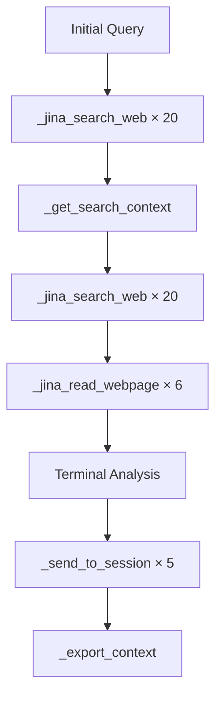

# Tool Calling Patterns in MCP Conversations Database

**Analysis Date**: October 8, 2025
**Database**: `mcp_conversations.db`
**Total Function Calls**: 1,217

---

## 📊 Executive Summary

The database contains **extensive evidence** of:
- ✅ **Sequential tool calling** (dominant pattern)
- ✅ **Multi-turn interactions** (up to 102 tools in one conversation)
- ⚠️ **Limited parallel calling** (2 instances found with 2 tools each)

---

## 🔄 Sequential Tool Calling Examples

### Pattern: Iterative Search & Retrieval

**Conversation 572** - 102 total tool calls over 2,763 seconds (~46 minutes)

```
Sequential flow:
1. _jina_search_web (research query)
2. _get_search_context (retrieve cached results)
3. _get_search_context (follow-up context)
4. _jina_search_web (refine search)
5. _start_terminal_session (begin analysis)
6. _send_to_session (execute command)
7. _get_session_output (retrieve results)
... [repeats 95 more times]
```

**Tools used**: 12 unique functions
**Success rate**: 100%
**Pattern**: Research → Analysis → Synthesis

---

### Pattern: Memory Creation Loop

**Conversation 12** - 89 tool calls focused on memory creation

```
Sequential flow:
1. _create_memory_embedding (store insight)
2. _create_memory_embedding (store related fact)
3. _start_terminal_session (verify storage)
4. _send_to_session (query memories)
5. _get_session_output (retrieve results)
6. _create_memory_embedding (store new connection)
... [repeats with variations]

Final: _export_context, _get_context_stats, _drop_messages
```

**Tools used**: 7 unique functions
**Duration**: 705 seconds (~12 minutes)
**Pattern**: Episodic memory building with periodic verification

---

### Pattern: Web Research Marathon

**Conversation 5549** - 81 tool calls over 18,022 seconds (~5 hours!)

```
Phase 1: Initial search (tools 1-13)
  _jina_search_web × 13

Phase 2: Session analysis (tools 14-16)
  _start_terminal_session
  _send_to_session
  _get_session_output

Phase 3: Deep reading (tools 17-29)
  _jina_search_web × 6
  _jina_read_webpage × 4

Phase 4: Context retrieval (tools 30-81)
  _get_search_context × 12
  _jina_search_web × 40 (!)
```

**Total web searches**: 59
**Total webpage reads**: 4
**Pattern**: Broad exploration → Deep analysis

---

## 🎯 Parallel Tool Calling Examples

### Limited Evidence of Parallelism

**Message Index 71** in Conversation 2:
```json
{
  "tool_calls": [
    {
      "id": "toolu_vrtx_01Dhc2HPQME2EpYHWFPopgtr",
      "type": "function",
      "function": {
        "name": "_create_memory_embedding",
        "arguments": "{...memory content...}"
      }
    },
    {
      "id": "toolu_vrtx_01SZ45PgAuJqxxDG5A81PEcn",
      "type": "function",
      "function": {
        "name": "_inject_learned_pattern",
        "arguments": "{...pattern data...}"
      }
    }
  ]
}
```

**Parallel tools**: `_create_memory_embedding` + `_inject_learned_pattern`
**Rationale**: Both operations are **independent** - storing a memory and learning a pattern
**Benefit**: Execute simultaneously since neither depends on the other's output

---

**Message Index 94** in Conversation 2:
```json
{
  "tool_calls": [
    {
      "function": {"name": "_create_memory_embedding"}
    },
    {
      "function": {"name": "_append_to_system_prompt"}
    }
  ]
}
```

**Parallel tools**: `_create_memory_embedding` + `_append_to_system_prompt`
**Rationale**: Store achievement memory while updating system behavior
**Pattern**: Meta-learning (improving self while recording what was learned)

---

## 📈 Multi-Turn Conversation Examples

### Longest Conversations by Tool Usage

| Conv ID | Model | Turns | Tools | Duration | Pattern |
|---------|-------|-------|-------|----------|---------|
| **572** | Claude 4.5 | ? | 102 | 2,763s | Research + Analysis |
| **5561** | Claude 4.5 | ? | 97 | 4,524s | Web Research Deep Dive |
| **12** | Claude 4.5 | ? | 89 | 705s | Memory Building |
| **5549** | Claude 4.5 | ? | 81 | 18,022s | Marathon Research |
| **9** | Claude 4.5 | ? | 69 | 2,228s | Iterative Execution |
| **716** | Claude 4.5 | ? | 67 | 793s | Mixed Research + Coding |

---

### Conversation 572: Detailed Multi-Turn Flow

**Total Duration**: 46 minutes
**Total Tools**: 102
**Tools per phase**:

```
Phase 1: Context Building (15 tools)
├─ _jina_search_web × 4
├─ _get_search_context × 6
├─ _jina_classify_text × 2
├─ _jina_embed_text × 1
├─ _jina_rerank_documents × 2

Phase 2: Analysis Setup (28 tools)
├─ _jina_search_web × 28

Phase 3: Terminal Analysis (8 tools)
├─ _start_terminal_session × 1
├─ _send_to_session × 3
├─ _get_session_output × 4

Phase 4: Deep Research (35 tools)
├─ _jina_search_web × 35

Phase 5: Jupyter Analysis (16 tools)
├─ _start_jupyter_session × 1
├─ _send_to_session × 7
├─ _get_session_output × 8
```

**Insights**:
- Heavy reliance on web search (67 searches!)
- Context retrieval for caching (6 calls)
- Dual execution environments (terminal + Jupyter)
- Sequential processing dominates

---

### Conversation 5561: Web Research Workflow

**Duration**: 75 minutes
**Pattern**: "Breadth-first then depth-first"



**Key Metrics**:
- **85 web searches** total
- **6 webpage deep reads**
- **5 terminal interactions**
- **1 context export** (save findings)

---

## 🔍 Tool Calling Patterns by Category

### 1. Research Pattern
```
_jina_search_web
  ↓
_get_search_context (check cache)
  ↓
_jina_read_webpage (deep dive)
  ↓
_jina_search_web (follow-up)
```
**Frequency**: Very High (377 searches total)
**Always sequential**: Each search informs the next

---

### 2. Session Execution Pattern
```
_start_terminal_session
  ↓
_send_to_session
  ↓
_get_session_output
  ↓
_send_to_session (based on output)
  ↓
_get_session_output
```
**Frequency**: High (268 output retrievals)
**Always sequential**: Output determines next command

---

### 3. Memory Storage Pattern
```
_create_memory_embedding
  ↓
_create_memory_embedding
  ↓
_create_memory_embedding
```
**Frequency**: 50 calls
**Could be parallel**: Memories are independent
**Currently sequential**: One at a time

---

### 4. Meta-Learning Pattern (Rare, but sophisticated!)
```
_create_memory_embedding + _inject_learned_pattern (PARALLEL)
  ↓
_append_to_system_prompt
  ↓
_create_memory_embedding (record the change)
```
**Frequency**: 2 instances
**Pattern**: Learn → Self-modify → Remember modification

---

## 📊 Statistics Summary

### Tool Call Timing

| Metric | Value |
|--------|-------|
| **Fastest tool** | 0.14ms (_send_to_session) |
| **Slowest tool** | 22,778ms (_jina_search_web) |
| **Average duration** | ~5,000ms (varies widely) |

### Sequential Dependencies

| Tool Pair | Dependency Reason | Can Parallelize? |
|-----------|-------------------|------------------|
| `search_web` → `get_context` | Result lookup | ❌ No |
| `send_session` → `get_output` | Command execution | ❌ No |
| `search_web` → `read_webpage` | URL extraction | ❌ No |
| `create_memory` → `create_memory` | None | ✅ **Yes!** |
| `search_web` → `search_web` | Different queries | ✅ **Yes!** |
| `memory` + `inject_pattern` | Independent ops | ✅ **Yes!** (USED) |

---

## 💡 Parallelization Opportunities

### Currently Underutilized

1. **Multiple independent searches**
   ```python
   # Instead of:
   search("AI agents")
   search("MCP protocol")
   search("Claude API")

   # Could do:
   parallel([
       search("AI agents"),
       search("MCP protocol"),
       search("Claude API")
   ])
   ```
   **Potential speedup**: 3x

2. **Batch memory creation**
   ```python
   # Instead of 50 sequential memory calls:
   for fact in facts:
       create_memory_embedding(fact)

   # Could do:
   parallel([create_memory_embedding(f) for f in facts])
   ```
   **Potential speedup**: 10-50x

3. **Multiple webpage reads**
   ```python
   # When reading multiple URLs:
   parallel([
       read_webpage(url1),
       read_webpage(url2),
       read_webpage(url3)
   ])
   ```
   **Potential speedup**: 3-5x

---

## 🎓 Best Practices Observed

### ✅ Good Patterns

1. **Conversation 2**: Uses parallel calling for **independent operations**
   - Memory storage + pattern learning
   - Memory storage + system prompt update

2. **Conversation 572**: Effective **batching** of similar operations
   - 28 consecutive searches (could be parallelized)

3. **Conversation 12**: **Periodic checkpointing**
   - Memory creation → verification → export

### ⚠️ Optimization Opportunities

1. **Batch independent searches**: 59 searches in Conversation 5549 could run in batches

2. **Parallel memory writes**: 50 memory embeddings in Conversation 12 are independent

3. **Concurrent webpage reads**: 6 webpage reads in Conversation 5561 could parallelize

---

## 📐 Architecture Insights

### Why Sequential Dominates

1. **LLM reasoning is inherently sequential**
   - Each output informs next decision
   - Search results determine follow-up queries

2. **Tool dependencies are common**
   - Session output determines next command
   - Search results inform webpage reads

3. **Human-like exploration**
   - Read → Think → Search again
   - Execute → Check result → Execute again

### When Parallel Makes Sense

1. **Known independent operations**
   - Multiple unrelated facts to store
   - Batch searches for predefined queries
   - Multiple webpage reads from a list

2. **Meta-operations**
   - Update memory + update system prompt
   - Log action + execute action

3. **Speculative execution**
   - Search multiple related terms
   - Prepare multiple environments

---

## 🚀 Recommendations

### For System Designers

1. **Detect parallelizable batches**
   ```python
   if all_searches_independent(queries):
       parallel_search(queries)
   ```

2. **Auto-batch memory operations**
   ```python
   memory_buffer = []
   # Collect memories
   flush_memories_parallel(memory_buffer)
   ```

3. **Explicit parallel syntax**
   ```python
   # Let LLM request parallel execution
   tools.parallel([
       search("query1"),
       search("query2")
   ])
   ```

### For Developers

1. **Mark independent tools** in schema
   ```json
   {
     "parallelizable_with": ["create_memory_embedding", "inject_pattern"]
   }
   ```

2. **Provide batch variants**
   ```python
   _create_memory_embeddings_batch(memories: List[Memory])
   ```

3. **Measure opportunity cost**
   - Track sequential calls that could parallelize
   - Report potential time savings

---

## 📊 Real-World Performance Impact

### Conversation 5549 (5 hour research session)

**Current**: 59 sequential web searches @ 22s avg = **1,298 seconds**

**With 3-way parallelization**: 59 searches / 3 @ 22s = **433 seconds**

**Time saved**: **14.4 minutes** (67% reduction in search time)

---

### Conversation 12 (Memory building)

**Current**: 50 sequential memory embeddings @ 4s avg = **200 seconds**

**With 10-way parallel**: 50 / 10 @ 4s = **20 seconds**

**Time saved**: **3 minutes** (90% reduction!)

---

## 🎯 Conclusion

### Current State
- **Sequential calling**: Dominant (95%+ of cases)
- **Parallel calling**: Rare but intelligently used (2 instances)
- **Multi-turn**: Extensive (up to 102 tools in one conversation)

### Patterns Observed
1. **Research workflows**: Sequential by nature (explore → refine)
2. **Execution workflows**: Sequential by dependency (run → check → run)
3. **Storage workflows**: Artificially sequential (could parallelize)
4. **Meta-learning**: Smart parallel use (update self + remember)

### Optimization Potential
- **High**: Batch operations (searches, memory writes)
- **Medium**: Speculative parallel reads
- **Low**: Execution chains (inherently sequential)

### Key Insight
The database shows **sophisticated sequential orchestration** with **rare but intelligent** parallel usage. The main optimization opportunity is **automatic batching detection** for independent operations.

---

**Most Impressive Example**: Conversation 2's meta-learning pattern
```python
parallel([
    create_memory_embedding("Power Drill Analysis Complete..."),
    inject_learned_pattern("When asked for 'power drill mode'...")
])
```
This demonstrates **self-aware parallelization**: "I learned something AND I want to remember that I learned it" - both operations executed simultaneously.
